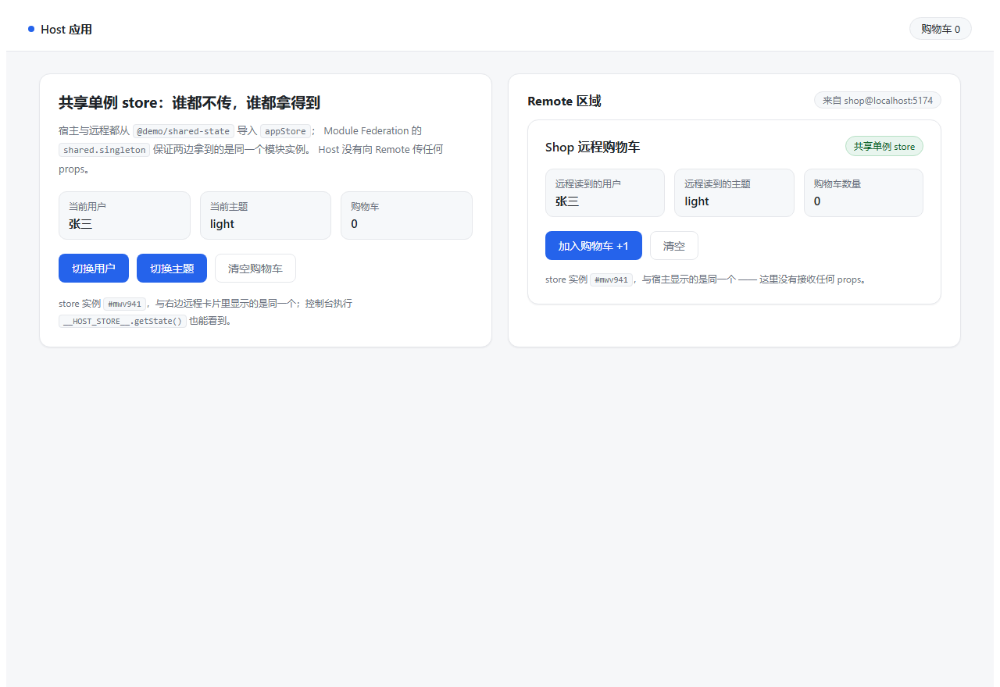
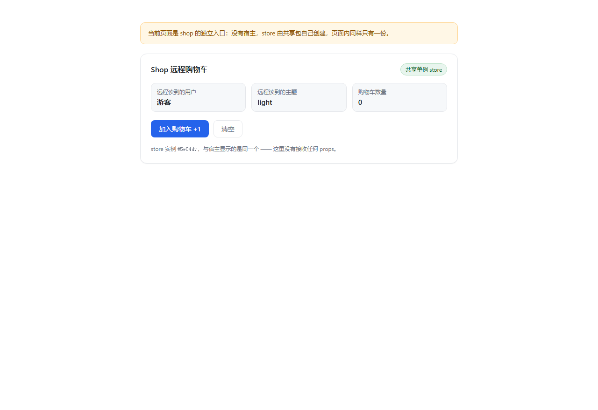

# MF 2.0 + Zustand 全局状态共享 Demo（共享单例版）

一个最小可运行的 **Vite + pnpm monorepo** 示例，演示用 **共享单例 store** 做跨应用状态共享：

- `@demo/shared-state` 在模块顶层导出一个 `appStore` 单例
- 宿主与远程都直接 `import { appStore }`，**不需要传 props、不需要 Context / Provider**
- Module Federation 的 `shared.singleton` 保证两边拿到的是同一个模块实例 → 同一个 store

技术栈：Vite 7 · React 19 · Zustand 5 · TypeScript 5.9 · @module-federation/vite

## 预览

宿主与远程各自渲染，但显示的是**同一个 store 实例**（注意两边的 `store 实例 #xxxxxx`）：



shop 独立运行（没有宿主，页面内同样只有一份单例，由共享包自己创建）：



## 目录

```
.
├── apps
│   ├── host                  # 宿主：写入初始状态、组合远程
│   │   ├── src/main.tsx      # appStore.setState({ user }) —— 没有 Provider
│   │   ├── src/App.tsx       # <RemoteCart /> —— 没有传 props
│   │   └── vite.config.ts    # federation({ remotes: { shop } })
│   └── shop                  # 远程：直接 import 单例
│       ├── src/Cart.tsx      # 暴露 ./Cart，useAppStore(...) 直接读
│       ├── src/standalone.tsx# 独立入口（命令行式写入游客态）
│       └── vite.config.ts    # federation({ exposes: { './Cart' } })
└── packages
    └── shared-state          # 状态 + 共享配置，以源码形式被消费
        ├── package.json      # exports：. / ./factory / ./mf-config
        └── src
            ├── store.ts      # createAppStore() 定义（不对外导出）
            ├── singleton.ts  # export const appStore = createAppStore()  ← 核心
            ├── hooks.ts      # useAppStore(selector) 直接订阅 appStore
            ├── factory.ts    # 工厂出口（@demo/shared-state/factory）
            ├── contracts.ts  # CartAppProps（现在只剩 title）
            └── config
                └── mf-config.ts  # 核心依赖版本 + shared/shareScope（@demo/shared-state/mf-config）
```

## 对外 API

业务代码只认两个入口，**拿不到创建实例的能力**：

```ts
// 主入口：读 + 订阅
import { appStore, useAppStore } from '@demo/shared-state';

// 子路径：只有测试 / 显式多实例才用
import { createAppStore } from '@demo/shared-state/factory';
```

```ts
export const appStore = createAppStore();   // 全项目唯一的创建点
```

这样“在业务代码里随手 `createAppStore()`”在 **typecheck 阶段就会报错**
（`TS2305: Module '"@demo/shared-state"' has no exported member 'createAppStore'`），
不用靠口头约定。

> `shared-state` 的 `exports` 直接指向 `./src/index.ts`，Vite 与 tsc 都直接读源码。
> 好处是改共享包不用构建、不会出现「dist 过期导致 404」这类问题。

## 快速开始

```bash
pnpm install
pnpm dev              # 并行启动 host:5173 / shop:5174
```

## 演示点

| 操作 | 观察什么 |
|---|---|
| 点远程的「加入购物车 +1」 | 宿主顶部的「购物车 N」同步 +1 |
| 点宿主的「切换主题」 | 远程卡片的主题、文案同步变化 |
| 点宿主的「切换用户」 | 远程显示的「用户」同步变化 |
| 对比两侧 `store 实例 #xxxxxx` | 完全一致 → 证明是同一个 store |
| 打开 5174 | 独立页面内同样是单例，只是没有宿主写入 |

控制台：

```js
__HOST_STORE__.getState()   // 宿主与远程共用这一份
```

## 共享单例是怎么实现的

> 想看更完整的原理拆解（模块缓存 → 构建期改写 → 运行时注册表 → 边界与失效场景），
> 见 [docs/shared-store-principle.md](docs/shared-store-principle.md)。

### 1. 模块顶层的 `createStore`

```ts
// packages/shared-state/src/singleton.ts
export const appStore = createAppStore();
```

模块只求值一次 —— 一个页面里无论被 import 多少次，`createStore()` 只执行一遍。

### 2. 让这个模块在页面里也只有一个实例

两边共用**同一份配置对象**（`@demo/shared-state/mf-config`），避免手抄漂移：

```ts
// packages/shared-state/src/config/mf-config.ts —— 仓库里唯一一份
import type { ModuleFederationOptions } from '@module-federation/vite';

/** 核心依赖：写死精确版本，不允许范围 */
export const CORE_DEPENDENCIES = {
  react: '19.3.1',
  'react-dom': '19.3.1',
  zustand: '5.1.0',
  '@demo/shared-state': '1.0.0',
} as const;

export const SHARE_SCOPE = 'global-app-scope';

const core = (name) => ({
  singleton: true,
  strictVersion: true,                       // 版本不符直接报错，不降级
  requiredVersion: CORE_DEPENDENCIES[name],   // 精确版本，例如 '19.3.1'
  shareScope: SHARE_SCOPE,
});

export const sharedConfig: NonNullable<ModuleFederationOptions['shared']> = {
  react: core('react'),
  'react/': core('react'),
  'react-dom': core('react-dom'),
  'react-dom/': core('react-dom'),
  zustand: core('zustand'),
  '@demo/shared-state': core('@demo/shared-state'),
};
```

核心包的版本号和 shared 配置都集中在 [config/mf-config.ts](packages/shared-state/src/config/mf-config.ts)，
配合 `strictVersion: true` 形成三道闸门：

| 闸门 | 时机 | 作用 |
|---|---|---|
| `pnpm check:deps` | 命令执行前 | 比对「声明版本」与「实际安装版本」，不一致直接失败 |
| `requiredVersion` 精确匹配 | 运行时 | 对方必须提供完全相同的版本 |
| `strictVersion: true` | 运行时 | 不满足就抛错，而不是静默降级 |

```bash
pnpm check:deps   # ✓ react 19.3.1 / ✓ zustand 5.1.0 …
```


```ts
// apps/host/vite.config.ts 与 apps/shop/vite.config.ts
import { sharedConfig } from '@demo/shared-state/mf-config';

federation({ /* ... */ shared: sharedConfig });
```

> 配置用插件自己的 `ModuleFederationOptions['shared']` 标注类型，所以不需要手写
> `Record<string, ...>`——那样会因为缺少隐式索引签名而和插件的类型对不上。

关于 **share scope**：

- 默认名字是 `'default'`；这里显式命名为 `global-app-scope`，调试时一眼能认出来；
- 注册表按 `实例 → scope 名 → 包名 → 版本` 分层，**scope 名相同才会进同一张表**；
- 名字不一致 = 各用各的池子 = 两份 store，而且不会报错；
- 要同时存在两套 React，才需要开多个 scope 做隔离。

MF 在加载时协商：先加载的一方把模块实例注册进共享作用域，后加载的一方直接复用。
**少了这一条，两边各求值一次，就是两份 store —— 而且不会报错，只会数据不同步。**

### 3. 组件层只剩一个 hook，没有 Context

```ts
// packages/shared-state/src/hooks.ts
export function useAppStore<T>(selector: (s: AppState) => T): T {
  return useStore(appStore, selector);   // 直接订阅单例
}
```

因为全页面只有一个实例，不存在“从组件树上取”的需求，所以 Context 和 Provider 都被删掉了。
状态共享发生在**模块解析层**，与 Context 无关。

需要命令式读写时直接 `import { appStore }`：

```ts
appStore.setState({ theme: 'dark' });
appStore.getState().cartCount;
appStore.subscribe((s) => console.log(s.user));
```

## 从 props 下发版改过来的差异

| 文件 | 改动 |
|---|---|
| `singleton.ts` | 新增：模块级单例 |
| `hooks.ts` | 新增：`useAppStore` 直接读单例（替代 `context.tsx`） |
| `context.tsx` | **已删除**：不再有 `AppStoreProvider` / `useAppStoreApi` |
| `contracts.ts` | `CartAppProps` 去掉 `store`，只剩 `title` |
| `host/main.tsx` | 去掉 `createAppStore()` 与 `<AppStoreProvider>`，改成 `appStore.setState(...)` |
| `host/App.tsx` | `<RemoteCart store={store} />` → `<RemoteCart />` |
| `shop/Cart.tsx` | 删掉兜底 store 与内层 Provider，直接 `useAppStore(...)` |

## 两种模式对比

| | 共享单例（当前） | props 下发 |
|---|---|---|
| 接入成本 | 极低：两边都 import 就行 | 需要宿主传、远程接 |
| 状态所有权 | 共享包（谁都能写） | 宿主唯一 |
| 一个页面多实例 | 做不到 | 天然支持 |
| 测试注入 | 需要给模块做替换（如 alias / vi.mock） | 直接传 mock |
| 独立运行 | 天然可用 | 需要兜底 |
| 主要风险 | 忘了配 shared；谁都能改状态 | 传参链路变长 |

如果将来确实需要“同一页面挂两个独立 store”，再把 `createContext` + `Provider` 加回来即可：
工厂在 `@demo/shared-state/factory`，`hooks.ts` 里把 `useStore(appStore, …)` 换成
`useStore(useContext(Ctx), …)` 就能恢复局部覆盖能力。

## 验证

```bash
pnpm typecheck        # 三个包全绿
pnpm check:deps       # 核心依赖「声明版本 vs 实际安装版本」
pnpm verify           # 无头浏览器跑一遍交互（需先 pnpm dev）
pnpm inspect          # 打印 MF 共享作用域里的注册记录
pnpm screenshot       # 重新生成 README 用的两张截图
```

`pnpm inspect` 会把 `window.__FEDERATION__.__SHARE__` 里每个包的注册记录打出来——
排查“到底是同一个实例还是各有一份”时最直接。正常情况应该看到
`@demo/shared-state` 只有一条 `1.0.0` 记录，且 `singleton: true`。

`pnpm verify` 会启动无头 Chrome，真实点击按钮并断言 17 项，包括：

- 宿主与远程显示的 **storeId 完全一致**（同一个实例）
- 远程点击 → 宿主计数同步；宿主切换主题/用户 → 远程同步
- 远程独立运行时使用自己的游客态

## 常见坑

| 现象 | 原因 |
|---|---|
| 状态两份、互不同步 | `@demo/shared-state` 没进 `shared`，或两侧 shared 配置不一致 |
| 改了共享包页面没反应 | Vite 对「应用根目录之外」的文件监听不可靠，重启一次 dev server |
| `Invalid hook call` | `react` 没单例，或 `react/jsx-runtime` 没被共享 |
| 无限重渲染 | selector 返回新对象且没用 `useShallow` |
| 页面里出现两个 store | 在应用代码里又调了一次 `createAppStore()`（主入口已不导出，写不出来） |
| 浏览器报 404 / 模块加载失败 | 换代过多导致缓存错乱：删掉 `apps/*/node_modules/.vite` 后重启 |
